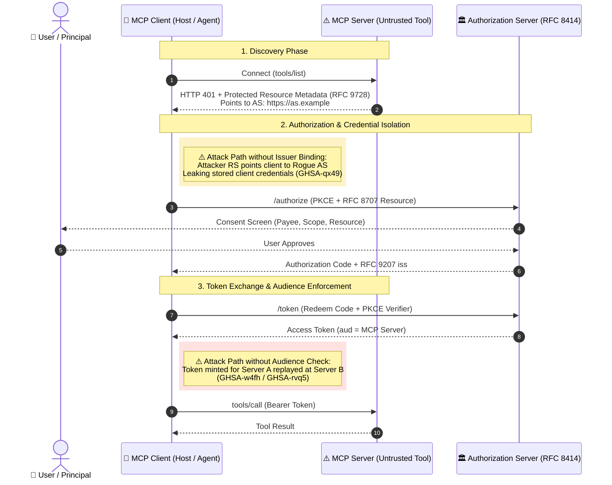
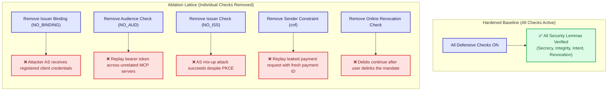

# Proving MCP Authorization: What We Modeled, What We Rediscovered, and Why Every Check Matters

## The question

AI agents are shifting from conversational assistants into autonomous systems that take real-world actions on behalf of users: querying sensitive APIs, orchestrating tools, and initiating financial transactions. The Model Context Protocol (MCP) has emerged as an open standard connecting clients and LLMs to external tools and resources. But in MCP authorization—built on OAuth 2.1 foundations—there is an essential architectural twist: an untrusted resource server (the MCP server) that a client connects to directs the client to an Authorization Server (RFC 9728).

If an agent connects to an untrusted MCP server, what prevents that server from misdirecting the client, hijacking credentials, stealing tokens, or escalating authorization scopes? Can we mathematically *prove* that client and server defenses hold together under adversarial network conditions?

> [!IMPORTANT]
> **The Threat Inversion:** In traditional OAuth, a human navigates to an authorization server they know and trust. In MCP, the tool provider specifies the authorization server. If metadata validation or audience verification is skipped, every downstream security invariant collapses.



---

## What we did

To answer this question rigorously, we developed a comprehensive formal specification of MCP authorization using the Tamarin prover, a state-of-the-art symbolic verification tool. Operating under the classical Dolev-Yao threat model, Tamarin evaluates an active network attacker who can intercept, alter, delete, and inject messages, while concurrently operating malicious servers, rogue clients, and compromised user accounts.

Our formal verification base consists of 9 distinct Tamarin models (`models/01`–`models/09`):

- **Model 01:** Authorization server selection, metadata issuer validation (RFC 8414 §3.3), and client credential binding.
- **Model 02:** Authorization code grant with PKCE (RFC 7636), issuer identification (RFC 9207), resource indicators (RFC 8707), and per-session state.
- **Model 03:** Client ID Metadata Documents (CIMD), where a single client identity and signing key are used across multiple authorization servers.
- **Model 04:** Enterprise authorization via Identity Assertion Authorization Grants (ID-JAG), modeling RFC 8693 token exchange followed by an RFC 7523 JWT bearer grant.
- **Model 05:** Delegated AI agent payment mandates under rich authorization requests (RFC 9396), DPoP sender-constraints (RFC 9449), and online revocation (RFC 7009).
- **Model 06:** Audience injection defenses for CIMD clients authenticated via `private_key_jwt` (RFC 7523bis).
- **Model 07:** Confused-deputy protections on MCP proxy servers implementing dynamic client registration.
- **Model 08:** Token passthrough and audience circumvention across intermediary servers and downstream APIs.
- **Model 09:** Server-driven scope step-up handling and resource-bound consent caching.

Across all 9 models, 376 lemma expectations are continuously checked in CI with zero well-formedness warnings.

---

## The ablation idea

Formal proofs often evaluate a protocol only in its "fully hardened" state—with every defensive check active simultaneously. However, software implementers frequently ask pragmatic questions: *Is every single check strictly necessary? What happens if an SDK omits one check? Does check A render check B redundant?*

To resolve this, we constructed a systematic ablation lattice across the protocol suite, documented in [docs/ablation.md](https://github.com/HarshThumar/mcp-auth-tamarin/blob/main/docs/ablation.md). In an ablation run, we disable security checks one subset at a time (where each preprocessor flag corresponds to one check) and execute the theorem prover across all combinations:

- Does the property still hold? (Proved ✅)
- Does omitting the check produce a concrete attack trace? (Falsified ❌)
- Does omitting the check prevent honest runs from completing? (Vacuous)

With 100% of ablation cells decided, the machine-checked lattice reveals the exact minimal sufficient set of checks for each security property. The lattice confirms that the layered defenses are not arbitrary: each check targets a distinct vulnerability path, or forms an either/or redundancy pair (such as PKCE or `state` for session integrity). Omission of any necessary check reliably yields an executable attack trace in the prover.



---

## What it rediscovered

When security checks are ablated in the models, the theorem prover does not construct purely abstract counterexamples. Instead, it systematically exercises the conditions of published, already-fixed vulnerabilities across official MCP SDKs:

| Advisory / CVE | Protocol Clause | Model Flag | Real-World Consequence | Patch Status |
|:---|:---|:---|:---|:---:|
| **GHSA-qx49-fqc8-xw99** | RFC 8414 §3.3 | Model 01 `NO_BINDING` | Untrusted MCP server redirects client to attacker AS, leaking credentials | `🟢 Shipped` |
| **GHSA-w4fh-qvv9-3v23** | RFC 8707 §2 | Model 02 `NO_AUD` | Missing audience check allows replaying valid tokens across MCP servers | `🟢 Shipped` |
| **GHSA-rvq5-wwqv-78pq** | RFC 8707 §2 | Model 02 `NO_AUD` | Opt-in audience check defaults off in TypeScript SDK, exposing servers to replay | `🟢 Shipped` |
| **GHSA-6qxp-vccf-f47h** | MCP AS Binding | Model 01 / 03 | Client credentials stored without issuer stamping cross AS boundaries | `🟢 Shipped` |

None of these attack classes is new—each corresponds to an established vulnerability class or documented OAuth pitfall (such as AS mix-up despite PKCE under RFC 9207, or audience injection under RFC 7523). The value of this work is not finding new vulnerabilities, but providing a machine-checked verification map demonstrating that published fixes are formally sound and identifying where implementers risk regression.

---

## The India angle

As AI agents begin executing economic transactions, authorization moves from accessing data to authorizing irrevocable fund transfers. In India, the Unified Payments Interface (UPI) ecosystem already incorporates delegated payments through NPCI's UPI Circle (circulars `OC 201` and `OC-201B`), allowing primary account holders to delegate payment authority to secondary users and software agents within predefined limits.

In Model 05 and our accompanying whitepaper ([whitepaper/agent-payments-india.md](https://github.com/HarshThumar/mcp-auth-tamarin/blob/main/whitepaper/agent-payments-india.md)), we analyzed what an autonomous agent payment mandate must cryptographically bind:

- The principal's approved payee
- Explicit per-transaction and cumulative amount caps
- A single target payment server (audience restriction)
- A cryptographic key bound to the agent (proof of possession / DPoP)
- An active online revocation check

```
┌────────────────────────────────────────────────────────────────────────┐
│                   DELEGATED AGENT PAYMENT MANDATE                      │
├────────────────────────────────────────────────────────────────────────┤
│ • Principal ID: user@bank        • Payee: merchant@upi                 │
│ • Transaction Cap: ₹2,000        • Cumulative Budget: ₹10,000          │
│ • Audience: payment-server.bank  • Bound Key (cnf): ed25519-public-key │
│ • Online Status Endpoint: https://as.bank/mandates/{mid}/status        │
└────────────────────────────────────────────────────────────────────────┘
```

The ablation results for Model 05 establish that these six checks are mutually independent:

- **P10 (Money stays inside intent):** Holds if and only if consent binding, payee validation, amount cap, and payment-server audience checks are all simultaneously enforced.
- **P11 (No debit after cancellation):** Holds if and only if the payment server performs a per-payment online revocation lookup. Cryptographic key-binding cannot compensate for an absent revocation check.
- **P12 (Authentic agent requests):** Holds if and only if the agent proves possession of its private key. A one-time payment ID cache alone fails against replay if requests lack sender-constraint.

> [!NOTE]
> **Regulatory Alignment:** We mapped these machine-checked findings to Indian policy and security frameworks, including the RBI FREE-AI Committee Report (Sutras on Trust and Resilience), CERT-In AI Security Guidelines, and the DPDP Act 2023. We couldn't find prior formal work on UPI-style agent mandates (the literature search is logged in the repository and the search is not exhaustive).

---

## Reproduce it

Every lemma proof, model variant, and ablation result is fully reproducible. The entire environment is packaged into a self-contained Docker image:

```bash
docker build -t mcp-auth-tamarin .
docker run --rm mcp-auth-tamarin ./scripts/reproduce.sh
```

The script executes the complete suite, verifies all 376 lemma expectations, and outputs runtime benchmarks confirming that all properties verify or fail as specified.

---

## What's next / caveats

This repository provides the foundation for ongoing academic paper preparation. While symbolic verification provides mathematical certainty within defined boundaries, real-world deployments carry inherent limits:

- **Model abstraction boundaries:** Tamarin abstracts physical time and floating-point arithmetic (for example, the UPI model partitions transaction limits into discrete classes rather than currency arithmetic). Browser internals and side channels fall outside the symbolic model.
- **Literature scope:** While our survey spans major security venues (S&P, CCS, USENIX Security, CSF, NDSS), the search is not exhaustive.
- **Implementation verification:** We maintain a formal-to-implementation matrix in [docs/implementation-check.md](https://github.com/HarshThumar/mcp-auth-tamarin/blob/main/docs/implementation-check.md) comparing model lemmas against real SDK execution. Where client-side findings are under active coordinated disclosure with maintainers, details are withheld in triage.

> [!TIP]
> Formal verification provides protocol designers with machine-checked confidence before specifications and implementations freeze. As agentic protocols expand, formal models provide an essential tool for ensuring that delegated authority remains strictly bounded.

---

**Question for readers and protocol builders:** If you are building or integrating MCP clients, servers, or agent delegation systems: which assumptions in your authorization flow have been hardest to validate, and where do you observe the greatest divergence between OAuth specifications and actual SDK behavior?

---

## Links

- **Repository Root:** [github.com/HarshThumar/mcp-auth-tamarin](https://github.com/HarshThumar/mcp-auth-tamarin)
- **Results Write-up (R0–R16):** [docs/results.md](https://github.com/HarshThumar/mcp-auth-tamarin/blob/main/docs/results.md)
- **Ablation Lattice:** [docs/ablation.md](https://github.com/HarshThumar/mcp-auth-tamarin/blob/main/docs/ablation.md)
- **UPI Agent Payments Case Study:** [docs/case-study-upi.md](https://github.com/HarshThumar/mcp-auth-tamarin/blob/main/docs/case-study-upi.md)
- **India Agent Payments Whitepaper:** [whitepaper/agent-payments-india.md](https://github.com/HarshThumar/mcp-auth-tamarin/blob/main/whitepaper/agent-payments-india.md)
- **Formal Model → SDK Implementation Check:** [docs/implementation-check.md](https://github.com/HarshThumar/mcp-auth-tamarin/blob/main/docs/implementation-check.md)
- **Upstream Conformance Test Proposals (Issue #78):** [docs/conformance-test-draft.md](https://github.com/HarshThumar/mcp-auth-tamarin/blob/main/docs/conformance-test-draft.md)
