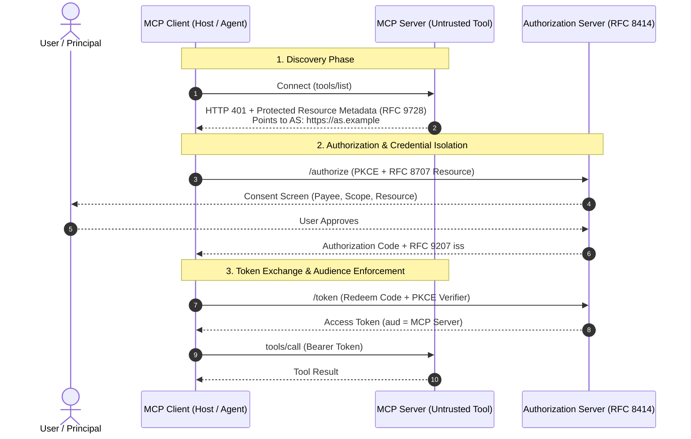
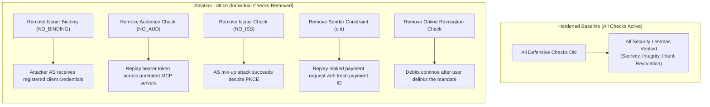

# Proving MCP Authorization: What We Modeled, What We Rediscovered, and Why Every Check Matters

## The question

When an AI agent connects to a local or remote tool via the Model Context Protocol (MCP), it relies on OAuth 2.1 to authorize requests. But MCP introduces an inversion of traditional OAuth assumptions: the resource server (the MCP tool server itself) is the entity that directs the client to an Authorization Server (RFC 9728). If that MCP server is untrusted, compromised, or malicious, what prevents it from pointing the client to a rogue authorization server, harvesting client credentials, or tricking the client into replaying tokens across different tools?

In production SDKs, multiple defenses are layered to prevent these failures: metadata issuer validation, client credential isolation, PKCE, authorization response issuer checks (`iss`), and resource-server audience validation. The practical engineering question is: can we prove that these defenses are sufficient, and what happens if an implementation omits or misconfigures one of them?



## What we did

During the IETF 127 Hackathon (14-15 November 2026, remote), we modeled the MCP authorization flow in the Tamarin prover, a symbolic verification tool for cryptographic protocols. Tamarin tests protocols against a standard Dolev-Yao attacker who controls the network, capable of intercepting, rewriting, and injecting traffic, while operating dishonest authorization servers, rogue resource servers, and malicious clients.

The repository contains 9 models (`models/01` through `models/09`):

- **Model 01:** Authorization server selection, metadata issuer validation (RFC 8414 Section 3.3), and client credential binding.
- **Model 02:** Authorization code grant with PKCE (RFC 7636), authorization response issuer identification (RFC 9207), resource indicators (RFC 8707), and per-session state.
- **Model 03:** Client ID Metadata Documents (CIMD, draft-ietf-oauth-client-id-metadata-document), where a single client identity and key are used across multiple authorization servers.
- **Model 04:** Identity Assertion Authorization Grants (ID-JAG, draft-ietf-oauth-identity-assertion-authz-grant), modeling RFC 8693 token exchange at an IdP followed by an RFC 7523 JWT bearer grant at an MCP authorization server.
- **Model 05:** Delegated agent payment mandates under rich authorization requests (RFC 9396), DPoP sender-constraints (RFC 9449), and online revocation (RFC 7009).
- **Model 06:** Audience injection defenses for CIMD clients authenticated via `private_key_jwt` (RFC 7523bis).
- **Model 07:** Confused-deputy protections on MCP proxy servers implementing dynamic client registration.
- **Model 08:** Token passthrough and audience circumvention across intermediary servers and downstream APIs.
- **Model 09:** Server-driven scope step-up handling and resource-bound consent caching.

Across these models, 376 lemma expectations are continuously checked in CI with zero well-formedness warnings.

## The ablation idea

Most formal protocol analyses only verify a single, fully hardened specification where every defense is enabled. While that shows the protocol can be secure, it does not tell implementers which checks are strictly necessary, which checks are redundant, or what concrete failure mode occurs when a specific check is omitted.

To answer this, we computed a complete ablation lattice across the protocol suite (`docs/ablation.md`). For each model, we systematically disabled security checks one subset at a time (where each preprocessor flag corresponds to one check) and ran the theorem prover across all combinations.

With 100% of ablation cells decided, the machine-checked lattice reveals the minimal sufficient check sets for every security property:
- It confirms that layered defenses are not arbitrary: each check addresses a specific attack path.
- It identifies true redundancy pairs (for example, PKCE or `state` is sufficient for session integrity, but omitting both allows code injection).
- It proves that omitting any single necessary check yields an executable attack trace in the prover.



## What it rediscovered

When checks are ablated in the models, the attack traces found by Tamarin directly reproduce the conditions of published, already-fixed vulnerabilities across official MCP SDKs:

| Advisory / CVE | Protocol Clause | Model Flag | Real-World Consequence | Status |
|:---|:---|:---|:---|:---|
| **GHSA-qx49-fqc8-xw99** | RFC 8414 §3.3 | Model 01 `NO_BINDING` | Untrusted MCP server redirects client to attacker AS, leaking credentials | Shipped |
| **GHSA-w4fh-qvv9-3v23** | RFC 8707 §2 | Model 02 `NO_AUD` | Missing audience check allows replaying valid tokens across MCP servers | Shipped |
| **GHSA-rvq5-wwqv-78pq** | RFC 8707 §2 | Model 02 `NO_AUD` | Opt-in audience check defaults off in TypeScript SDK, exposing servers to replay | Shipped |
| **GHSA-6qxp-vccf-f47h** | MCP AS Binding | Model 01 / 03 | Client credentials stored without issuer stamping cross AS boundaries | Shipped |

None of these attack mechanisms is new. Each corresponds to an established vulnerability class or documented OAuth pitfall (such as authorization server mix-up despite PKCE under RFC 9207, or audience injection under RFC 7523). The contribution is not claiming new vulnerabilities, but providing a machine-checked verification map demonstrating that published fixes are formally sound and identifying where implementers risk regression.

## The India angle

As AI agents begin executing financial operations, authorization shifts from accessing data to authorizing irrevocable fund transfers. In India, the Unified Payments Interface (UPI) ecosystem already incorporates delegated payments through NPCI's UPI Circle (circulars OC 201 and OC-201B), allowing primary account holders to delegate payment authority to secondary users and software agents within predefined limits.

In Model 05 and our accompanying whitepaper (`whitepaper/agent-payments-india.md`), we analyzed what an autonomous agent payment mandate must cryptographically bind:
1. The principal's approved payee
2. Explicit per-transaction and cumulative amount caps
3. A single target payment server (audience restriction)
4. A cryptographic key bound to the agent (proof of possession / DPoP)
5. An active online revocation check

The ablation results for Model 05 show that these controls are strictly independent:
- **P10 (Debit within intent):** Holds if and only if consent binding, payee validation, amount cap, and payment-server audience checks are all simultaneously enforced.
- **P11 (No debit after cancellation):** Holds if and only if the payment server performs a per-payment online revocation lookup. Cryptographic key-binding cannot compensate for an absent revocation check.
- **P12 (Authentic agent requests):** Holds if and only if the agent proves possession of its private key. A one-time payment ID cache alone fails against replay if requests lack sender-constraint.

We mapped these machine-checked findings to Indian policy and security frameworks, including the RBI FREE-AI Committee Report (addressing recommendations on Trust, Accountability, and Resilience), CERT-In AI Security Guidelines, and the DPDP Act 2023. We couldn't find prior formal work on UPI-style agent mandates (the literature search is logged in the repository and the search is not exhaustive).

## Reproduce it

Every lemma proof, model variant, and ablation result is fully reproducible via Docker without installing Tamarin or Maude locally:

```bash
docker build -t mcp-auth-tamarin .
docker run --rm mcp-auth-tamarin ./scripts/reproduce.sh
```

The script executes the full verification suite, checks all 376 lemma expectations, and outputs runtime benchmarks confirming that all properties verify or fail as specified.

## What's next / caveats

This repository provides the baseline for ongoing academic paper preparation. While symbolic verification provides mathematical certainty within the model's defined boundaries, real-world deployments carry limits that any formal abstraction simplifies:
- **Model abstraction boundaries:** Tamarin's symbolic model abstracts away physical time and floating-point arithmetic (for instance, the UPI model partitions transaction limits into discrete classes rather than currency arithmetic). Browser-level implementation quirks and side channels fall outside the symbolic model.
- **Literature scope:** While our survey spans major security venues (S&P, CCS, USENIX Security, CSF, NDSS), the search is not exhaustive.
- **Implementation verification:** We maintain a formal-to-implementation matrix in `docs/implementation-check.md` comparing model lemmas against real SDK execution. Where client-side findings are under active coordinated disclosure with maintainers, details are withheld in triage.

Formal verification provides protocol designers and SDK maintainers with machine-checked confidence before specifications and implementations freeze. As agentic protocols expand, formal models provide an essential tool for ensuring that delegated authority remains strictly bounded.

---

If you are building or integrating MCP clients, servers, or agent delegation systems: which assumptions in your authorization flow have been hardest to validate, and where do you observe the greatest divergence between OAuth specifications and actual SDK behavior?

---

## Links

- Repository Root: https://github.com/HarshThumar/mcp-auth-tamarin
- Results Write-Up (R0–R16): https://github.com/HarshThumar/mcp-auth-tamarin/blob/main/docs/results.md
- Ablation Lattice: https://github.com/HarshThumar/mcp-auth-tamarin/blob/main/docs/ablation.md
- UPI Agent Payments Case Study: https://github.com/HarshThumar/mcp-auth-tamarin/blob/main/docs/case-study-upi.md
- India Agent Payments Whitepaper: https://github.com/HarshThumar/mcp-auth-tamarin/blob/main/whitepaper/agent-payments-india.md
- Formal Model to SDK Implementation Check: https://github.com/HarshThumar/mcp-auth-tamarin/blob/main/docs/implementation-check.md
- Upstream Conformance Test Proposals (Issue #78): https://github.com/HarshThumar/mcp-auth-tamarin/blob/main/docs/conformance-test-draft.md
