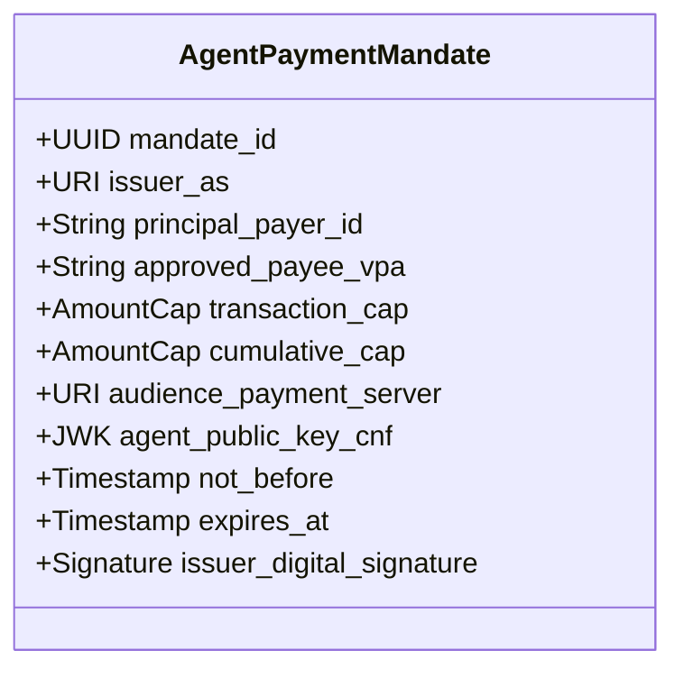
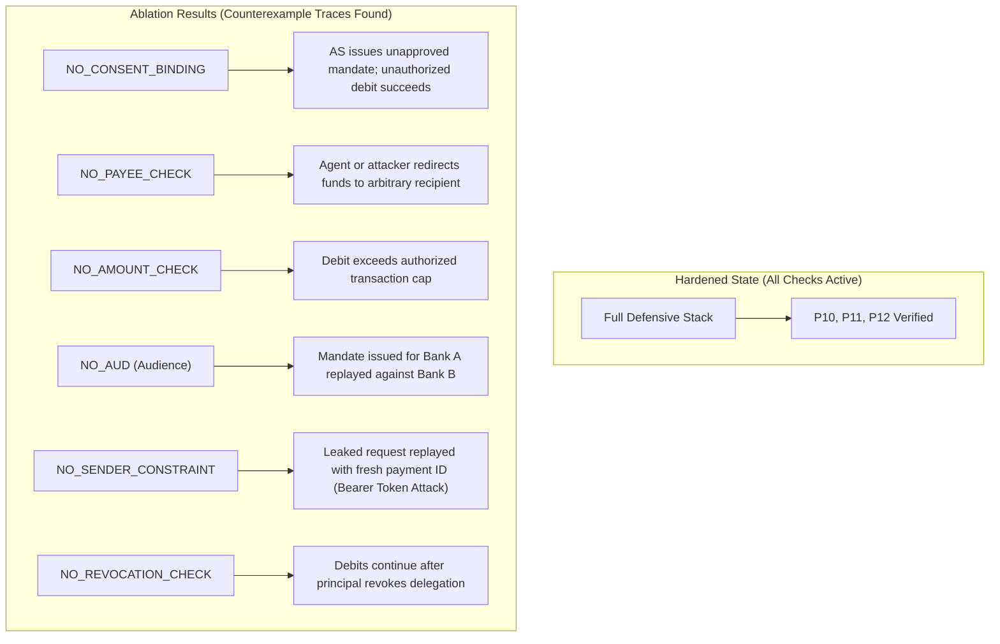

# Agent Authorization for Indian Payments, Formally

*Public draft for comment. Not legal advice, not a regulatory interpretation, and not endorsed by NPCI, RBI, CERT-In, or any standards body.*

## 1. Executive Summary

As artificial intelligence agents transition from informational assistants to transactional actors, they are increasingly tasked with executing financial operations on behalf of human principals. In India, the Unified Payments Interface (UPI) ecosystem has established a global benchmark for instant retail payments. Through NPCI's UPI Circle initiative (introduced in circular OC 201 and expanded to IoT devices and software entities in addendum OC 201-B), India already possesses a production framework for delegating payment authority from a primary account holder to a secondary user or automated software agent.

The central engineering and cryptographic question is:

> When an autonomous software agent executes payments under a delegated mandate, what guarantees that every debit remains strictly within the bounds approved by the human principal?

To answer this question without relying on informal assertions, we developed a machine-checked formal protocol model in the Tamarin prover (`models/05_agent_payment_mandate.spthy`). The model formalizes the interaction between a human principal (payer), an authorization server (issuing PSP/bank), an autonomous software agent, a payment server (acquiring PSP/switch), and an active Dolev-Yao network attacker who can intercept, alter, and inject network traffic, while accounting for leaked payment logs (as posited in the FAPI 2.0 attacker model).

The model incorporates modern OAuth 2.1 building blocks:
- **Rich Authorization Requests (RFC 9396):** Expressing granular financial scopes, merchant identities, and amount caps.
- **Resource Indicators (RFC 8707):** Binding mandates to explicit payment server audiences.
- **Demonstrating Proof-of-Possession (RFC 9449 DPoP):** Cryptographically binding mandates to agent-held asymmetric keypairs.
- **Online Token Revocation (RFC 7009):** Real-time lookup of mandate validity at execution time.

When all defensive checks are active, Tamarin mathematically verifies three core security lemmas across every possible execution trace:
1. **Lemma P10 (Debit Within Intent):** A debit occurs if and only if it targets the approved payee, at the designated payment server, within the authorized amount cap.
2. **Lemma P11 (Immediate Revocation Enforcement):** No payment succeeds after the human principal delinks or revokes the mandate.
3. **Lemma P12 (Authentic Agent Requests):** An honest agent's payment request cannot be forged, replayed, or manipulated by an attacker who observes previous network traffic or payment logs.

By systematically evaluating the complete 64-combination ablation lattice across these checks, we prove that these defensive mechanisms are orthogonal and non-redundant:

| Security Property | Necessary and Sufficient Check Set in Formal Model |
| :--- | :--- |
| **P10 (Debit within intent)** | Principal consent binding + Payee exact match + Amount cap + Payment server audience check |
| **P11 (No debit after cancellation)** | Per-payment real-time online revocation lookup at the payment server |
| **P12 (Authentic agent requests)** | Cryptographic proof-of-possession (DPoP sender-constraint) |

Omission of any single check enables a concrete, executable counterexample trace in the theorem prover. These findings map directly to the technical objectives of the RBI FREE-AI Committee Report, CERT-In AI Security Guidelines, and the DPDP Act 2023.

---

## 2. The Problem: Autonomous Agents Paying Under Delegated Mandates

In a traditional human-initiated payment, multi-factor authentication (MFA) provides a synchronized security perimeter: the account holder reviews the recipient and amount on a trusted screen and immediately inputs an out-of-band credential (such as a 4- or 6-digit UPI MPIN or biometric prompt).

Agentic payments fundamentally alter this paradigm. The human principal authorizes authority asynchronously in advance:
- "Pay my monthly electricity and broadband utility bills automatically."
- "Purchase flight tickets for my upcoming conference up to INR 8,000."
- "Procure inventory supplies from approved vendors whenever stock drops below threshold."

The agent—frequently driven by a Large Language Model (LLM) processing untrusted external inputs—acts at an arbitrary time later. If the agent is compromised, hallucinating, or subjected to indirect prompt injection via a malicious invoice or merchant webpage, it may attempt an out-of-policy transaction.

Because the human principal is not present during payment execution, the mandate itself becomes the sole authorization gate. In the absence of formal cryptographic constraints, three critical failure modes emerge:

1. **Mandate Distortion:** An authorization server or intermediary issues a mandate that exceeds the scope or amount approved by the principal.
2. **Out-of-Bounds Execution:** The agent submits a debit targeting an unauthorized payee, exceeding the cumulative limit, or routing the request through an unapproved payment intermediary.
3. **Post-Cancellation Zombie Debits:** The principal revokes delegation in their banking application, but because downstream payment nodes rely on unexpired token timestamps or static TTL caches, debits continue until the mandate window lapses.

These vulnerabilities cannot be mitigated by instructing the LLM to behave ethically. Safety must be enforced deterministically at the protocol and cryptographic boundaries of the payment infrastructure.

---

## 3. What an Agent Payment Mandate Must Bind

To resist symbolic and real-world adversaries, a payment mandate must serve as a cryptographically verifiable capability token binding six non-negotiable parameters:



1. **Payer Approval (Consent Stamping):** The mandate must contain non-repudiable evidence that the primary account holder authorized the specific parameters over an authenticated, agent-isolated channel.
2. **Payee Restriction:** The mandate must explicitly name the permitted payee Virtual Payment Address (VPA) or merchant identifier (exact string match, prohibiting wildcards or unverified prefix lookups).
3. **Transaction & Cumulative Amount Caps:** Strict financial limits defining both single-transaction thresholds and cumulative period ceilings.
4. **Audience Restriction (RFC 8707):** The mandate must identify the single designated payment server / switch authorized to process debits under it, preventing multi-gateway token redirection.
5. **Agent Key Binding (Proof of Possession / RFC 9449 DPoP):** The mandate must embed the public key (`cnf` claim) of the agent. Every outbound payment request must include a fresh cryptographic signature generated by the agent's private key over the transaction payload.
6. **Online Revocation Endpoint (RFC 7009):** The payment server must verify the real-time status of the mandate against an authoritative revocation registry at the moment of debit execution.

---

## 4. Formal Model & Ablation Lattice Analysis

We specified the payment delegation lifecycle in Tamarin Prover (`models/05_agent_payment_mandate.spthy`), evaluating the protocol against a standard Dolev-Yao attacker who has complete control over network transit (intercepting, modifying, injecting, and replaying packets). In alignment with the FAPI 2.0 security profile, transaction requests are assumed to be leakable (for example, through server access logs or telemetry sinks).

### The Security Lemmas
- **Lemma P10 (debit_within_intent):**
  $$\forall \text{payer, agent, payee, amount, time} \cdot \text{Debit}(\text{payer, payee, amount}) \implies \text{Approved}(\text{payer, payee, cap}) \land (\text{amount} \le \text{cap})$$
- **Lemma P11 (no_debit_after_cancellation):**
  $$\forall \text{payer, mandate, time} \cdot \text{Debit}(\text{mandate}) \text{ at } t_2 \land \text{Revoke}(\text{mandate}) \text{ at } t_1 \implies t_2 < t_1$$
- **Lemma P12 (authentic_agent_requests):**
  $$\forall \text{agent, payment\_id} \cdot \text{Honest}(\text{agent}) \land \text{Process}(\text{payment\_id}) \implies \text{Initiated}(\text{agent, payment\_id})$$

### The Ablation Lattice
By systematically ablating checks one at a time across all 64 permutations, Tamarin revealed the precise causal relationship between defensive controls and failure traces:



### Orthogonality Proof
The theorem prover proved that these defenses are **strictly non-interchangeable**:
- Proof-of-possession (DPoP) key binding does not protect against post-revocation debits if online revocation is omitted.
- Online revocation lookup does not prevent token replay if sender-constraints are omitted.
- Amount cap validation does not prevent payee redirection if payee validation is omitted.

Each check is mathematically necessary to secure its designated invariant.

---

## 5. Architectural Alignment with Indian Frameworks

### NPCI UPI Circle (OC 201 & OC 201-B)
NPCI circular OC 201 (August 2024) introduced UPI Circle to enable primary account holders to delegate payment authority to trusted secondary users. Addendum OC 201-B (October 2025) expanded this capability to IoT devices and software applications.

UPI Circle specifies two operational modes:
1. **Full Delegation (Spend With Limit):** The primary user establishes a monthly limit (up to INR 15,000) and max-per-transaction limits (up to INR 5,000). The secondary delegate initiates and completes payments without requiring primary user authentication per transaction.
2. **Partial Delegation (Approve Each Payment):** The secondary delegate initiates payments, but the primary user authenticates each debit with their UPI MPIN.

Autonomous AI agents operate under **Full Delegation**. Our formal analysis provides the cryptographic foundation for this mode: to prevent secondary software delegates from becoming confused deputies or vectors of catastrophic loss, the mandate exchanged across the UPI switch must cryptographically enforce RFC 9396 rich limits, RFC 9449 sender constraints, and real-time online status checks.

### RBI FREE-AI Committee Recommendations
The Reserve Bank of India's Committee on Framework for Responsible and Ethical Enablement of AI in Financial Services (FREE-AI Report, August 2025) formulated core principles (*Sutras*):
- **Trust & Accountability:** AI transactions must be fully attributable to verifiable consent artifacts.
- **Resilience:** Systems must fail closed against adversarial network manipulation.
- **Explainability & Auditability:** Every financial decision must produce deterministic cryptographic audit logs.

The formal model satisfies these principles by replacing probabilistic agent assertions with deterministic, mathematically verified protocol checks.

### Digital Personal Data Protection (DPDP) Act 2023
Section 6 of the DPDP Act mandates that consent must be free, specific, informed, unconditional, and withdrawable at any time. In autonomous agent payments:
- The rich authorization request enforces *specificity* (exact payee and capped amount).
- The online revocation check guarantees *withdrawable consent* in real time, terminating an agent's debit capability the moment withdrawal is recorded.

---

## 6. Implementation Checklist for Financial Institutions

For PSPs, banks, and payment network operators implementing autonomous agent mandates:

### Mandate Creation (Issuance Phase)
1. **Out-of-Band Consent:** Capture human authorization via a dedicated channel inaccessible to the agent (e.g., banking app with biometric or MPIN authentication).
2. **Explicit Parameter Stamping:** Encode exact payee identifiers, transaction ceilings, expiration timestamps, target payment server URI, and the agent's public key into a signed mandate JWT.
3. **Short Lifetimes:** Set mandate expiration windows conservatively; enforce explicit user re-authorization rather than automatic rollover.

### Payment Execution (Verification Phase)
4. **Mandate Signature & Expiration:** Verify the authorization server's digital signature and ensure current time falls within valid timestamps.
5. **Audience Exact Match:** Reject any mandate that does not list the processing payment server in its `aud` claim.
6. **Payee Enforcement:** Perform strict character-by-character string validation against the approved payee list.
7. **Amount Cap Enforcement:** Check both per-transaction amounts and cumulative running totals against approved limits.
8. **DPoP Sender Constraint Verification:** Validate the agent's cryptographic signature over the HTTP request and payment identifier against the key stamped in the mandate. Reject unsigned requests.
9. **Real-Time Revocation Check:** Query the central revocation repository (or distributed status ledger) synchronously before committing funds. Do not rely on local token expiration windows.
10. **Replay Cache:** Maintain a synchronized payment ID cache to ensure one-time request processing.

---

## 7. Verification & Reproduction

All models, lemmas, and ablation test suites are open source and machine-reproducible:

```bash
# Clone the formal verification repository
git clone https://github.com/HarshThumar/mcp-auth-tamarin.git
cd mcp-auth-tamarin

# Run the complete test suite via Docker (Tamarin 1.12.0 / Maude 3.5.1)
docker build -t mcp-auth-tamarin .
docker run --rm mcp-auth-tamarin ./scripts/reproduce.sh

# Run Model 05 (Agent Payment Mandates) specifically
ONLY=05 ./scripts/prove.sh
```

---

## 8. References & Primary Sources

1. **NPCI:** Unified Payments Interface Operating Circular OC 201-B (8 October 2025): *Introduction of IoT devices / software on UPI Circle*.
2. **Reserve Bank of India:** Report of the Committee on Framework for Responsible and Ethical Enablement of Artificial Intelligence (FREE-AI), PR 2025-2026/902 (13 August 2025).
3. **CERT-In:** *Technical Guidelines on SBOM, QBOM, CBOM, AIBOM and HBOM (Version 2.0)* (9 July 2025); *Blueprint for Defending against AI-Assisted Exploitation in Digital Infrastructure (Version 1.0)* (25 May 2026).
4. **Ministry of Electronics and Information Technology (MeitY):** *Digital Personal Data Protection Act, 2023 (Act No. 22 of 2023)* and *DPDP Rules 2025*.
5. **IETF Standards & Drafts:** RFC 9396 (Rich Authorization Requests); RFC 8707 (Resource Indicators); RFC 9449 (DPoP); RFC 7009 (Token Revocation); draft-mishra-oauth-agent-grants-02 (OAuth Profile for Delegated AI Agent Authorization).
